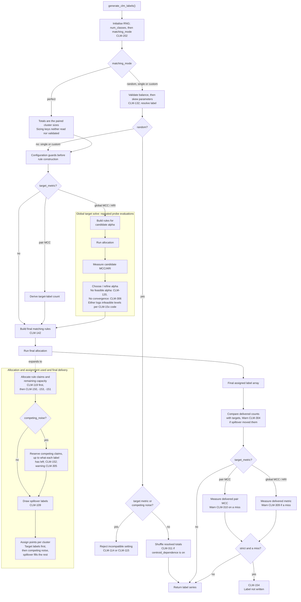

<a href="https://archive.softwareheritage.org/browse/origin/?origin_url=https://doi.org/10.5281/zenodo.21759538">
  
</a>

## Purpose

`clm_label_engine.py` takes a dataset that already has cluster ids
`c(x) in {clusters}` (ground truth or algorithm output, it does not matter
which) plus, optionally, the point coordinates `X`, and produces a second label
`L(x) in {0,...,M-1}` whose statistical and geometric relationship to `c(x)` is
fully specified by a `clm_label` config rather than measured after the fact.

The engine is a set of pure functions: one
top-level entry point, `generate_clm_labels(cluster_labels, coords, cfg, seed)`,
composes the stages below and returns a `pandas.Series` of length `N`, values in
`{0,...,M-1}`. Everything is deterministic under `seed`.

## Top-level flow: `generate_clm_labels`

```
rng          = default_rng(seed)
M = cfg.num_classes; assert 1 <= M <= MAX_CARDINALITY (64)  # [CLM-126]
cluster_ids  = sorted unique of c(x);  K = len(cluster_ids)
assert K <= MAX_CARDINALITY (64)                             # [CLM-127]
cluster_sizes[k] = |{x : c(x)=k}|
m_counts     = resolve_label_counts(cfg, N, rng)          # Stage 1
if perfect:  m_counts = cluster sizes (requires M==K)     # Stage 2
if random:   return draw-from-p, shuffled (early return)  # Stage 2
validate spillover concentrated_labels [CLM-128], centroid favors [CLM-129],
    and target_metric (incl. scope==pair guards [CLM-123/124/130])
if target_metric:                                         # Stage 7
    if scope==pair: m_counts = _pair_label_counts(...); alpha = 1  # 7a exact, single mode
    else:           alpha    = solve_alpha_for_target_metric(...)  # 7b numerical, global
    rules = build_rules(override=alpha)
else:               rules = build_rules(cfg, cluster_ids) # Stage 2
out = run_allocation_pipeline(...)                        # Stages 3-6
```

## Cardinality guard (`MAX_CARDINALITY`, [CLM-126]/[CLM-127])

Before any other work, `num_classes` (M) and the dataset's own cluster count (K,
derived from `c(x)`, not configured) are each checked against a fixed cap of 64.
This is a coarse safety backstop against runaway/typo configs, not a validated
statistical-significance boundary, internal testing already finds CLM results
unreliable well below this ceiling (K above ~15, M above ~20); computing a real
per-dataset significance limit is future work (a dedicated module, or manual
guidance), not something this guard attempts. The check lives once, at this
top-level entry point, the same place as the `_ensure_coords` geometry guard;
lower-level helpers like `resolve_label_counts` remain uncapped when called
directly. As a side effect, `num_classes=0` now fails here with a coded error
instead of the unguarded `1/M` `ZeroDivisionError` it used to hit inside
`resolve_label_counts`.

## Stage 1: Label totals (`resolve_label_counts`, `_skewed_proportions`, `_largest_remainder_counts`)

Produces the exact integer count `m_l` of each label over all `N` points,
`sum m_l = N`.

- `balance: balanced` -> uniform `1/M`; any explicit `proportions` are ignored
  (warns `[CLM-301]`).
- `balance: unbalanced` -> explicit `proportions` take precedence (must have
  exactly `M` entries, else `[CLM-121]`, and sum to 1, else `[CLM-106]`);
  otherwise `skew_rule` is the fallback:
  `geometric` (`p_i ~ ratio^i`), `dominant_minority` (one dominant class, uniform
  rest), or `dirichlet` (one seeded `Dirichlet(alpha)` draw, reproducible).
  Unknown rule -> `[CLM-107]`.
- Proportions become exact integer counts by the **largest-remainder** method
  (floor each `p_l*N`, hand the leftover units to the largest fractional
  remainders, a tie to the earlier label), avoiding the drift of independent
  per-class rounding. Every count in the engine is computed from the values as
  written (`0.7` is 7/10, not the float nearest it), so written values that tie
  tie: 0.7 and 0.3 of 1435 points are 1004.5 and 430.5, and give 1005 + 430. Skew
  rules are exact from their settings (`dominant_share: 0.7` of two labels leaves
  3/10). Explicit `proportions` that sum to 1 only within the `[CLM-106]` tolerance
  are divided by their sum first.

## Stage 2: Matching mode → rule list (`build_rules`, `_check_pair`)

Every mode is normalized to a uniform list of `Rule(label, clusters, recall_target)`.

- **`perfect`**: requires `M == K` (`[CLM-102]`); one rule per cluster at recall
  `1`. Label counts are forced to the paired cluster sizes, so
  `proportions/balance/skew_rule` are ignored (warns `[CLM-302]`), and the result
  recovers `c(x)` exactly (MCC = 1). Incompatible with `target_metric` (`[CLM-111]`).
- **`single`**: requires `M >= 2, K >= 2` (`[CLM-103]`) and a
  `single_match: {cluster k*, label l*}`. Semantics are **budget-into-`k*`**:
  `recall * m_{l*}` points of `l*`, rounded, are placed inside `k*` (default recall
  `1`), so every `l*`-labeled point lies in `k*`; feasibility needs
  `|k*| >= floor(recall * m_{l*})`.
- **`random`**: `L(x)` drawn from the resolved proportions, independent of
  `c(x)`; returns early (no allocation/placement). Rejects `target_metric`
  (`[CLM-114]`) and `competing_noise` (`[CLM-115]`).
- **`custom`**: one `Rule` per `assignment_matrix` row: route a
  `recall_target` fraction of one label's budget into a chosen set of clusters
  (surjective, partial, and overlapping between labels allowed; one label names a
  cluster once).

`_check_pair` validates every rule up front: `label in 0..M-1` (`[CLM-104]`) and
each referenced cluster exists (`[CLM-105]`), failing fast before any numpy
IndexError/KeyError. `_check_named_once` then refuses a cluster named twice for one
label, in two rows or in one (`[CLM-142]`): two rows added their points, and one
row listing a cluster twice lost points in the split.

## Stage 3: Allocation + feasibility (`allocate`, `_split_row_allocation`)

Before any rule claims a point, every `competing_noise` cluster must exist in this
dataset (`[CLM-119]`, which skips the dataset as `[CLM-105]` does for a rule's
cluster). Each rule claims `recall_target * m_label` points of its label. Rules that
name the same label together take the closest integer to the sum of their claims (a
half to even), split among them by largest remainder (a tie goes to the earlier
row). Each rule's count `tp` is then split across its clusters
(`split_rule: proportional_to_size | equal`; a single cluster short-circuits). Three
feasibility checks raise `InfeasibleAllocationError`: a rule's claim, rounded down,
exceeds the rule's cluster capacity (`[CLM-150]`), the `recall_target` values of the
rules on one label add up past 1.0 (`[CLM-153]`, since each is a fraction of the
label's WHOLE budget, so repeats add up), or no rounding of the rules' counts fits
the clusters (`[CLM-151]`). Each count may be its claim rounded down or up: when the
closest rounding overfills a cluster, `_fit_rounding` moves one point at a time
along the shortest path, to another cluster of the same rule, to another rule of the
same label, or by rounding the label's total down (0.5 x 11 + 0.5 x 7 + 1.0 x 1 =
10 points of a 10-point cluster take 6 + 3 + 1). A rounding that fits exists
whenever every cluster holds the unrounded claims (an integral flow), and the search
finds one whenever any exists. The Stage-1 label counts are fixed by then: a label
rounded up there can be refused where another rounding of the label counts would fit
(ROADMAP, "Integer network flow"). Output: `demand[k][label]` and the
`remaining_capacity[k]` of every cluster.

## Stage 4: Optional structured competing noise (`_competing_demand`)

If `competing_noise` is present, each entry converts `share` of ONE cluster's
**unclaimed** points into one specific competing label, to be placed
core/boundary/random. The claims follow one order: the Stage-1 label counts, the
Stage-3 rules (at the searched level under Stage 7b), competing noise, spillover. A
conflict within one of them is refused, and a later one takes what the earlier ones
leave. Under `proportional_to_marginal` the entries of one label therefore place
together at most what its rules left of its count, shared in proportion to what
each asks, and the label counts stay exact. Entries on the same cluster together
take the closest integer to the sum of their `share * unclaimed`, split by largest
remainder (a tie goes to the earlier entry). Where that rounding takes a label's
entries past what it has left (1.5 + 1.5 of 3 points as 2 + 2), the entries rounded
up with the smallest fractions are rounded down instead, a tie keeping the earlier
entry's. An entry that places fewer points than its share asks, or none, warns
`[CLM-305]`, naming why: its cluster is full, its share rounds to 0, or its label has
too little left. It is warned only for the delivered labeling, never by a Stage 7b
search probe. Cluster, label, share and favors (`[CLM-116..118]`), one entry per
label and cluster (`[CLM-142]`) and a label that is not one of the cluster's
targets (`[CLM-144]`) are checked once by `_validate_competing_noise_cfg`, before
allocation and the search, since they hold for every dataset. Here: joint capacity
(`[CLM-152]`).

## Stage 5: Spillover (`_spillover_draws`)

Fills the capacity left unclaimed by Stages 3-4:
`proportional_to_marginal` restores each label to its Stage-1 target count
exactly; `uniform` spreads leftovers evenly (breaks proportions);
`concentrated` dumps them into `concentrated_labels` (default: the largest
label). Unknown rule -> `[CLM-109]`. `_spillover_draws` reads `M` from the config,
not from `len(m_counts)` (deriving it from the counts array is what let a too-long
`proportions` widen the label space; see `[CLM-121]`), and `concentrated_labels` is
validated up front by `_validate_spillover_cfg` (`[CLM-128]`: a list of integer ids
in `0..M-1`; a bare number would otherwise be read by numpy as a *range*).

Breaking the proportions is no longer silent: after allocation,
`generate_clm_labels` compares the delivered counts against the Stage-1 targets
and warns `[CLM-304]`, naming the rule, when `uniform`/`concentrated` moved them.
Checked against the achieved counts rather than predicted from the config, so a
rule set that leaves no leftover capacity (nothing for the rule to fill) stays
quiet.

## Stage 6: Spatial placement (`assign_points_in_cluster`, `_weighted_pick`)

Within each cluster the demanded labels are assigned to specific points, then the
spillover pool fills the rest. With `centroid_dependence` enabled, *which* points
receive each label is drawn by weighted sampling without replacement, weights
from a profile of the distance to the cluster centroid (`linear`, `exponential`
with `steepness`, or deterministic top-`tp` `step`), favouring `core` or
`boundary` (validated exact and case-sensitive up front by `_validate_centroid_cfg`,
`[CLM-129]`, so a `Core` typo cannot silently invert the placement); unknown
profile -> `[CLM-110]`. The target labels are placed first; the `competing_noise`
labels follow, each with its own core/boundary/random placement
(`favors_overrides`), in the points the targets leave. The order changes which
points carry a label, never how many per cluster.

**Key invariant:** placement operates strictly after allocation. The
cluster--label contingency table, and therefore MCC and ARI, is fixed by
Stages 1-5, so spatial structure can be varied (core vs. boundary vs. random)
while MCC/ARI stay identical. This orthogonality is combinatorial, not geometric:
it holds even for non-convex clusters whose centroid is meaningless.

## Stage 7: Target-metric solving

Set only under `single`/`custom` (validated by `_validate_target_metric_cfg`:
mode, with `M >= 2` and `K >= 2` under `custom` (`[CLM-111]`: one class or one
cluster leaves a single labeling, so every metric is fixed), `type in {mcc, ari}`,
`value in [-1,1]`, `strict` a boolean (`[CLM-141]`), `scope in {pair, global}`, and, for
`scope: pair`, `type: mcc` + `single` mode + an up-front `_check_pair` of the
`single_match` cluster/label so a bad id raises `[CLM-104]`/`[CLM-105]` rather
than a raw KeyError/IndexError, plus `[CLM-130]`, which rejects any
`spillover_rule`/`competing_noise` that could place `l*` outside `k*`: `uniform`
spillover, `concentrated` onto `l*` (or its unset default), or a `competing_noise`
entry emitting `l*`). All three top-level validators (`_validate_spillover_cfg`,
`_validate_centroid_cfg`, `_validate_target_metric_cfg`) run before any solve, so a
bad config surfaces as itself rather than as a solved score over an invalid
labeling. Two paths:

### Stage 7a: exact single-pair MCC (`_pair_label_counts`, `scope: pair`)

For `scope: pair` (`single` mode, `type: mcc`) the target is the 2x2 MCC of the
`single_match` `(k*, l*)` pair, which inverts in **closed form**, no search.
Placing *all* of label `l*` inside cluster `k*` (recall 1, so no leftover spills
back in) makes the pair phi `= sqrt(m_c (N - n_k) / (n_k (N - m_c)))`; inverting
for the label size gives `m_c* = phi^2 n_k N / (N - n_k(1 - phi^2))`. The engine
resizes `l*` to `m_c*` (overriding its proportion; `[CLM-308]` warns when that
changes the label's size), rescales
the other labels to keep `sum(m_counts) == N` (uniform fallback when they were all
zero), and sets `alpha = 1`. The reachable range is `[phi_min, 1]` (`phi_min` at
`m_c = 1`); a target outside it is clamped to the nearest reachable value with
`[CLM-307]`. The range (`pair_reachable_range`) is logged on every pair run and
written to the dataset's summary txt, inside the range or not. The solve is exact only while every `l*` point stays inside
`k*`; `[CLM-130]` (Stage 7 above) rejects the settings that could break that up
front, and after generation `[CLM-310]` re-measures the delivered pair MCC and
warns if it still landed outside tolerance (the counterpart of `[CLM-306]` for the
global solver; the message names the cause: `l*` holds whole points, so the
reachable values step past the target, or the target was clamped by `[CLM-307]`).
With `strict: true` that miss is refused: `[CLM-154]` takes the warning's place,
names the reachable range and whether the target lies inside it, and the label is
not written.

### Stage 7b: global metric (`solve_alpha_for_target_metric`, `scope: global`, default)

For `scope: global` (default; `mcc` or `ari`, `single`/`custom`), one global
recall level `alpha` is substituted into every rule and solved numerically, there
is no closed form for the global multiclass metric. A coarse grid scan brackets
the target (guarding against non-monotonicity of the achieved metric) and `brentq`
refines it; all probes share a fixed seed (common random numbers), so differences
reflect `alpha`, not noise. The feasible levels are not assumed to form one
interval: `alpha = 0` claims no point, so without `competing_noise` it is always
feasible, and the `[CLM-150]`/`[CLM-153]` claims only grow with `alpha`, but
`competing_noise` converts a share of the points the rules leave unclaimed, which
shrink as `alpha` grows, so `[CLM-152]` can block low levels while high ones fill the
cluster. The refinement stays between grid levels that fit, so the search also probes
inside a grid step where the outcome changes, in two cases only: no grid level fits and
`[CLM-152]` is followed by another code (the levels that fill the noisy cluster exactly,
often a band narrower than a step), or the target was missed and a level that fits
neighbours one that does not. It halves that step down
to half a point of the largest label, the levels it finds join the refinement, and
every probe after the grid counts against `max_iter`. Every infeasible probe keeps its
`[CLM-15x]` error, and a missed target
logs one warning per code naming the levels it blocked. If
the request exceeds the geometry's **structural ceiling**, the solver returns its
closest feasible value with a `[CLM-306]` non-convergence warning rather than
crashing or fabricating a hit (`[CLM-120]` if *no* probed `alpha` is feasible at
all, which leaves that dataset's label out and lets the run continue).

Two values describe that ceiling. The run reports them and acts on neither.
The **size ceiling** depends only on the cluster and label counts: it is
the highest value any labeling with those counts can score,
`MetricCeilings.rk_ceiling` for `mcc` (exact, and always reached) and
`MetricCeilings.ari_bound` for `ari` (a bound that is not always reached). It is
computed once the label counts are settled, before the search, and only when
nothing can move them: `uniform`/`concentrated` spillover deliver other counts at
other recall levels, which have other ceilings, so no size ceiling is reported
then (`competing_noise` cannot move them, Stage 4). `[CLM-306]` names it and says when the target lies
above it. The rules can hold a configuration well below it, which is why a
configuration's own ceiling is not computed in advance. For `K` equal clusters
and `M <= K` equal labels the size ceiling is `sqrt(M(M-1)/(K(K-1)))`; for other
counts that formula is not a bound. The **highest value found** is the best any
search probe scored, read off the probes already run. A grid can step over a
higher value, so it is what the configuration reaches at least, not at most.
Both are logged after the final generation, returned through
`generate_clm_labels(..., report=...)` and written to the summary txt.

The probe stream (`default_rng(probe_seed)`) defaults to the output
stream (`default_rng(seed)`), so the labeling the search scored is the one
delivered. Only an explicit `probe_seed` other than the run seed separates them;
the engine re-measures the labeling it actually writes and warns `[CLM-309]` when
it lands outside tolerance at a value the search did not score, the achieved value
being authoritative rather than the request (most visible at small `N`, where
spillover placement is a large share of the outcome).

With `strict: true` the delivered value is checked once more, after the final
generation and after `[CLM-306]`/`[CLM-309]`: outside `value ± tolerance` it raises
`[CLM-154]` (an `InfeasibleAllocationError`) instead of returning the closest
labeling. An absent `tolerance` is 0 then, and a difference below `1e-12` counts as
a hit, so an exact value is met. The message repeats the highest value found and
the size ceiling; `report=` is filled before the raise.


## Config schema

```yaml
global_settings:
  data_source: "clustbench"        # clustbench | mdcgen | fabricated_data | byoc
  output_dir: "OUTPUT"             # base folder for the timestamped run folders

clustbench_suite:                  # key must be "{data_source}_suite"
  batteries: ["sipu"]               # "all" or a list
  datasets: ["unbalance"]           # "all" or a list
  seed: 42                          # only used by mdcgen/fabricated_data; ignored by clustbench

label_generation:
  n_labels: 1                       # produces Label_0, Label_1, ...
  source_labeling: "labels0"        # which ground-truth labeling to key CLM math off
  noise: 0.15                       # fallback only, if clm_label is omitted
  seed: 42

  clm_label:
    # 1. CARDINALITY & BALANCE ------------------------------------------------
    num_classes: 3                  # M, the number of labels (1-64)
    balance: "unbalanced"           # balanced -> uniform 1/M (proportions ignored, warns)
                                     # unbalanced -> proportions below, else skew_rule
    proportions: [0.5, 0.3, 0.2]    # used directly when balance == "unbalanced"
    skew_rule: "geometric"          # fallback when unbalanced AND no proportions given:
                                     #   geometric          p_i ~ ratio^i
                                     #   dominant_minority  one dominant class, uniform rest
                                     #   dirichlet          Dirichlet(alpha), drawn once per seed
    skew_params: {ratio: 0.5, dominant_index: 0, dominant_share: 0.6, alpha: 1.0}

    # 2. MATCHING MODE --------------------------------------------------------
    matching_mode: "custom"         # perfect | single | random | custom
    single_match: {cluster: 4, label: 0}       # required if matching_mode == single
    assignment_matrix:                          # required if matching_mode == custom
      - {label: 0, clusters: [1, 2], recall_target: 0.8}
      - {label: 1, clusters: [3],    recall_target: 0.5}
      - {label: 2, clusters: [3],    recall_target: 0.3}

    # 3. ALLOCATION -----------------------------------------------------------
    split_rule: "proportional_to_size"          # proportional_to_size | equal
    spillover_rule: "proportional_to_marginal"  # proportional_to_marginal | uniform | concentrated
                                     # NOTE: only proportional_to_marginal makes the achieved
                                     # label counts honor 'proportions'. uniform spreads leftover
                                     # points evenly; concentrated dumps them into one label.

    # 4. STRUCTURED COMPETING NOISE (optional; single/custom only) ------------
    competing_noise:
      - {cluster: 1, label: 2, share: 1.0, favors: "boundary"}
                                     # converts `share` of ONE cluster's UNCLAIMED
                                     # (leftover) points into a specific competing
                                     # label, placed at that cluster's boundary/
                                     # core/random. Withdrawn from the leftover pool
                                     # BEFORE spillover_rule above fills the rest.
                                     # Under proportional_to_marginal it places at
                                     # most what the rules leave of the label's
                                     # count, so 'proportions' hold. It changes the
                                     # achieved MCC/ARI; that structured-vs-random
                                     # contrast is its point.

    # 5. TARGET METRIC (optional; single/custom only) -------------------------
    target_metric: {type: "mcc", value: 0.6, tolerance: 0.01, max_iter: 40}
                                     # solves one global recall level so the achieved
                                     # mcc/ari meets 'value'; recall_target may be omitted
                                     # from the rules when this is present.
                                     # scope: "global" (default) targets the
                                     # whole-partition MCC/ARI by numerical search;
                                     # "pair" (single mode only) targets the 2x2 MCC of the
                                     # single_match cluster/label and is solved exactly and
                                     # instantly, sizing that label to sit inside its cluster.
                                     # strict: true (optional, false by default) refuses a
                                     # delivered value outside tolerance ([CLM-154]) instead
                                     # of writing the closest one; tolerance then defaults to 0.
    # target_metric: {type: "mcc", scope: "pair", value: 0.6}   # exact single-pair MCC

    # 6. SPATIAL PLACEMENT (optional) -----------------------------------------
    centroid_dependence:
      enabled: true
      profile: "linear"             # linear | exponential | step
      favors: "core"                # core | boundary
      steepness: 3.0                # exponential only
```

## Project layout

| File                                          | Role                                                                                                                                                                                                                                                                                                        |
|-----------------------------------------------|-------------------------------------------------------------------------------------------------------------------------------------------------------------------------------------------------------------------------------------------------------------------------------------------------------------|
| `../src/clmsynth/main.py`                     | Entry point, defaults to `test_data_config.yaml`.                                                                                                                                                                                                                                                           |
| `../src/clmsynth/dataset_sources.py`          | Online data sources: `clustbench` (Gagolewski benchmark downloads), `mdcgen` (synthetic, via `mdcgenpy`). For the two offline data sources see below.                                                                                                                                                       |
| `../src/clmsynth/_fabricated_generator.py`    | Feature generator with perfect-separation labels, used by the `fabricated_data` source.                                                                                                                                                                                                                     |
| `../src/clmsynth/byoc_source.py`              | Bring-your-own-clusters: imports user-provided CSV, with optional min-max standardization on import.                                                                                                                                                                                                        |
| `../src/clmsynth/label_context.py`            | `DatasetContext`, holds features, every ground-truth labeling, and every generated label.                                                                                                                                                                                                                   |
| `../src/clmsynth/label_generator.py`          | Orchestrates label generation: calls the CLM engine per `n_labels`, or falls back to simple noise-flipping if no `clm_label` config is given.                                                                                                                                                               |
| `../src/clmsynth/clm_label_engine.py`         | The CLM label-assignment: proportions/skew, matching modes, recall targets, allocation, spillover, competing noise, spatial placement, and the global target-metric solver.                                                                                                                                 |
| `../src/clmsynth/clm_errors.py`               | Diagnostics: message templates keyed by a `[CLM-###]` code (1xx `ValueError`, 15x `InfeasibleAllocationError`, 3xx warnings) plus helpers.                                                                                                                                                                  |
| `../src/clmsynth/metrics.py`                  | Three standalone measures: `clustering_mcc` (multiclass MCC / Gorodkin R_K, Hungarian-matched to maximise R_K), `clustering_mcc_pair` (the quantity `target_metric.scope: pair` with `type: mcc`), and `clustering_ari` (adjusted Rand index). `MetricCeilings`: the size ceiling. |
| `../src/clmsynth/_visualization.py`           | Scatter-plot, annotated with measured MCC/ARI and the generating config.                                                                                                                                                                                                                                    |
| `../src/clmsynth/config_template.py`          | The YAML template string used to render a config.                                                                                                                                                                                                                                                           |
| `../src/clmsynth/generate_config.py`          | Renders `config_template.py` into a runnable config YAML from an upstream payload file (default `../upstream_payload.yaml`).                                                                                                                                                                                |
| `../upstream_payload.yaml`                    | Example upstream payload: the minimal facts `generate_config.py` renders into the full config.                                                                                                                                                                                                              |
| `../src/clmsynth/_config_wizard.py`           | Interactive CLI wizard: asks and explains every option, then writes a config YAML.                                                                                                                                                                                                                          |
| `../src/clmsynth/_questions.py`               | The wizard's `Question`s per prompt (wording, help, default, range, `visible_when`), read by `_config_wizard.py`.                                                                                                                                                                                           |


- The global solver builds rules, runs allocation **and assignment**, then
  measures the candidate labeling on every probe. It is shown as a loop-shaped
  subgraph rather than every grid and `brentq` iteration.
- Spillover is an application stage after allocation (and, when configured,
  competing-noise reservation). The early `concentrated_labels` check is only a
  narrow configuration guard; it is not spillover itself.
- The engine checks a requested metric only after the final label array has
  been assigned. Pipeline reporting is separate again: it measures written
  labels after the CSV is saved.



## Scalability 

One allocation pass is linear in the number of points. One metric evaluation adds
two sort-based `np.unique` calls and one Hungarian assignment on a `K x M` matrix.
A solve costs a bounded number of probes `P` set by the target and `max_iter`, not
by `N`, and the engine re-runs once per generated label:

$$O\big(\underbrace{L}_{\text{n_labels}} \cdot \underbrace{P}_{\text{probes}} \cdot (N \log N + K^3)\big)$$

`K` and `M` are capped at 64, so `K^3` is a bounded constant and any fixed
configuration reduces to `O(N log N)`. Measured over 10^3 to 5x10^5 points, the
fitted exponent is 1.01-1.05 once fixed setup cost has amortised, which is not
distinguishable from linear in practice.
## Diagnostics (`clm_errors.py`)

Every raise/warning above carries a stable `[CLM-###]` code from a single
registry: `1xx` config `ValueError`, `15x` `InfeasibleAllocationError` (a
`ValueError` subclass, caught by the solver as "try another alpha" and by
`main.py` to skip the label; `[CLM-154]` is not a probe code: it is raised once,
after the final labeling, under `target_metric.strict`), `3xx` warnings. Missing required config keys
surface as `2xx` `MissingConfigKey`, a `KeyError` subclass; `main.py` stops the
run on one, since a required key has no default.

**Numbers that are also exit statuses.** A shell reports a process ended by a signal
as 128 plus the signal number. On a cluster these are common:

| Status | Signal  | Typical cause                                               |
|--------|---------|-------------------------------------------------------------|
| 134    | SIGABRT | a C library aborts                                          |
| 135    | SIGBUS  | `/dev/shm` full, or a memory-mapped file changed underneath |
| 136    | SIGFPE  | an arithmetic fault in compiled code                        |
| 137    | SIGKILL | out of memory, or past the time limit                       |
| 138    | SIGUSR1 | the scheduler's warning before a time limit                 |
| 139    | SIGSEGV | a segfault                                                  |
| 140    | SIGUSR2 | LSF's run-time limit                                        |
| 143    | SIGTERM | a cancelled job                                             |

A user who sees one of these and searches the troubleshooting guide for the number
should not land on a `[CLM-###]` code. So in 0.7.4 `[CLM-134]` moved to `[CLM-141]`,
and the two codes new in that release took 142 and 144 instead of 135 and 136. 141
(SIGPIPE, which Python ignores) and 142 (SIGALRM) rarely end a run.

The 1xx numbers up to 143 are reserved: 134 to 140 and 143 stay unused, and a new 1xx
code takes the next free number from 144. Older codes keep their numbers; the
troubleshooting guide footnotes `[CLM-120]`, `[CLM-124]`, `[CLM-130]`, `[CLM-132]`,
`[CLM-152]` and `[CLM-153]` with the exit status each is not. CLMSynth itself exits with 0, 1, 2, 3, 130 or 143.

## What it does *not* do

It does not synthesize features or cluster geometry (only fabricates features based on distribution rules if user intends),
`c(x)` and `X` are fixed inputs from upstream (a benchmark suite, MDCGen, an offline generator, or the
user's own CSV). It only decides which label each point gets.
